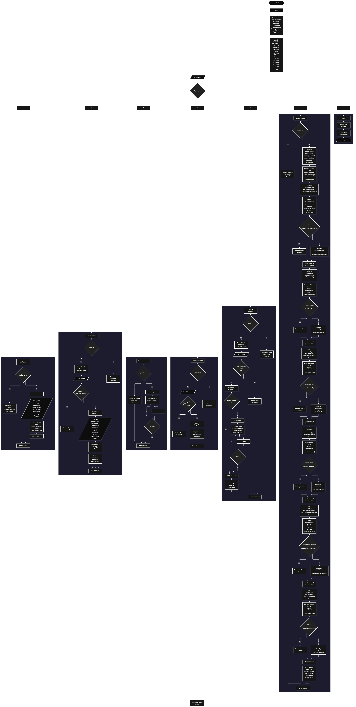

Este proyecto, llamado <b>astronauta virtual</b>, fue desarrollado en <b>java</b> como un ejercicio práctico para fortalecer la lógica de programación mediante la creación de un sistema de gestión de astronautas desde la consola. El programa cuenta con un menú principal de siete opciones que permite <b>registrar, editar, listar, buscar, eliminar y consultar un resumen</b> de los astronautas registrados. Cada astronauta almacena información como el nombre, la edad, la nacionalidad, la especialidad, la misión, el destino, la nave espacial, la fecha de lanzamiento, la duración de la misión, la experiencia y el estado, utilizando once arreglos paralelos con una capacidad máxima de <b>10 astronautas durante la ejecución</b>. Durante su desarrollo se aplicaron conceptos fundamentales de programación, como variables, arreglos, estructuras condicionales, ciclos repetitivos y estructuras de selección, además de procesos para buscar, modificar, eliminar y organizar registros. También se implementaron análisis de frecuencia y contadores para generar estadísticas sobre las especialidades, misiones, destinos, naves espaciales, nacionalidades y estados de los astronautas. Este proyecto permite poner en práctica los conocimientos adquiridos en java y sirve como base para desarrollar sistemas de gestión más avanzados utilizando otros lenguajes y tecnologías.

<h2 align="center">⚙️ Funcionamiento del menú principal</h2>

### ➕ Registrar astronauta

La opción <b>1) registrar astronauta</b> permite agregar un nuevo astronauta al sistema. Antes de realizar el registro, el programa comprueba que la cantidad de astronautas almacenados sea menor a la capacidad máxima de los arreglos mediante la condición <b>total &gt;= nombres.length</b>. Si se alcanza el límite de diez registros, muestra el mensaje <b>"no hay espacio para registrar mas astronautas."</b>, impidiendo agregar otro registro. Si existe espacio disponible, genera un identificador utilizando la expresión <b>total + 1</b> y solicita los once datos del astronauta: <b>nombre, edad, nacionalidad, especialidad, mision, destino, nave espacial, fecha de lanzamiento, duracion de la mision, experiencia y estado</b>. Los datos se almacenan en la posición correspondiente de sus respectivos arreglos, utilizando la variable <b>total</b> como índice. Finalmente, incrementa esta variable en uno y muestra el mensaje <b>"astronauta registrado correctamente."</b>. De esta manera, cada nuevo astronauta queda almacenado y disponible para las demás operaciones del sistema.

### ✏️ Editar astronauta

La opción <b>2) editar astronauta</b> permite modificar la información de un astronauta registrado. Primero, el programa comprueba si existen astronautas almacenados mediante la variable <b>total</b>. Si no hay registros, muestra el mensaje <b>"no existen astronautas registrados."</b>. En caso contrario, utiliza un ciclo <b>for</b> para presentar una lista con los identificadores y los once datos de cada astronauta. Después, solicita el identificador del astronauta que se desea editar y comprueba que se encuentre dentro del rango permitido mediante la condición <b>idEditar &gt;= 1 &amp;&amp; idEditar &lt;= total</b>. Si el identificador es válido, obtiene la posición correspondiente restando uno mediante la expresión <b>idEditar - 1</b>. A continuación, solicita el nuevo nombre, edad, nacionalidad, especialidad, mision, destino, nave espacial, fecha de lanzamiento, duracion de la mision, experiencia y estado, actualizando directamente los valores de los once arreglos. Finalmente, muestra el mensaje <b>"astronauta actualizado correctamente."</b>. Si el identificador seleccionado no corresponde a un astronauta registrado, presenta el mensaje <b>"id no encontrada."</b>.

### 📋 Listar astronautas

La opción <b>3) listar astronautas</b> permite visualizar todos los astronautas registrados actualmente en el sistema. Antes de mostrar la información, el programa comprueba si la variable <b>total</b> es igual a cero. Si no existen registros, presenta el mensaje <b>"no existen astronautas registrados."</b>. Si hay astronautas disponibles, utiliza un ciclo <b>for</b> para recorrer los arreglos desde la primera posición hasta la cantidad total de registros almacenados. Durante el recorrido, muestra el identificador de cada astronauta, calculado mediante <b>i + 1</b>, junto con su nombre, edad, nacionalidad, especialidad, mision, destino, nave espacial, fecha de lanzamiento, duracion de la mision, experiencia y estado. Esta función facilita consultar todos los registros existentes sin necesidad de buscar cada astronauta individualmente.

### 🔎 Buscar astronauta

La opción <b>4) buscar astronauta</b> permite localizar un astronauta mediante su identificador. Primero, el programa comprueba si existen astronautas registrados. Si el sistema está vacío, muestra el mensaje <b>"no existen astronautas registrados."</b>. En caso contrario, solicita el identificador del astronauta que se desea buscar y comprueba que se encuentre dentro del rango permitido mediante la condición <b>idBusqueda &gt;= 1 &amp;&amp; idBusqueda &lt;= total</b>. Si el identificador es válido, obtiene directamente la posición correspondiente utilizando la expresión <b>idBusqueda - 1</b> y muestra los once datos del astronauta encontrado. Si el identificador introducido no corresponde a ningún registro existente, presenta el mensaje <b>"id no encontrada."</b>. La búsqueda se realiza directamente mediante la posición del identificador, sin utilizar un ciclo para comparar los nombres almacenados.

### 🗑️ Eliminar astronauta

La opción <b>5) eliminar astronauta</b> permite eliminar un astronauta registrado mediante su identificador dentro de la lista. Antes de comenzar, el programa comprueba que existan astronautas almacenados. Si no hay registros, muestra el mensaje <b>"no existen astronautas registrados."</b>. Si existen astronautas disponibles, presenta una lista con sus identificadores y los once datos correspondientes. Después, solicita el identificador del astronauta que se desea eliminar y verifica que se encuentre dentro del rango válido mediante la condición <b>idEliminar &gt;= 1 &amp;&amp; idEliminar &lt;= total</b>. Si el identificador es correcto, obtiene la posición mediante <b>idEliminar - 1</b> y utiliza un ciclo <b>for</b> para desplazar una posición hacia la izquierda los datos de los astronautas posteriores en los once arreglos: <b>nombres, edades, nacionalidades, especialidades, misiones, destinos, naves, fechasLanzamiento, duraciones, experiencias y estados</b>. Posteriormente, disminuye la variable <b>total</b> en uno y muestra el mensaje <b>"astronauta eliminado correctamente."</b>. Esta reorganización permite mantener consecutivamente los registros activos después de eliminar un astronauta. La última posición no se limpia explícitamente, ya que el programa controla los registros válidos mediante la variable <b>total</b>.

### 📊 Mostrar resumen

La opción <b>6) mostrar resumen</b> permite consultar estadísticas generales sobre los astronautas registrados. Primero, el programa comprueba si existen registros mediante la variable <b>total</b>. Si no hay astronautas almacenados, muestra el mensaje <b>"no existen astronautas registrados."</b>. En caso contrario, inicializa seis contadores para clasificar los astronautas según su estado: <b>entrenamiento, misionProgramada, enMision, misionCompletada, retirados y otrosEstados</b>. Mediante un ciclo <b>for</b> y estructuras condicionales <b>if, else if y else</b>, recorre el arreglo <b>estados</b> y compara cada registro utilizando el método <b>equalsIgnoreCase()</b>, que permite realizar comparaciones sin distinguir entre mayúsculas y minúsculas. Después, realiza seis análisis de frecuencia mediante ciclos <b>for</b> anidados para identificar la especialidad más frecuente, la misión más utilizada, el destino más frecuente, la nave espacial más utilizada, la nacionalidad más frecuente y el estado más frecuente. Para estos análisis utiliza los arreglos <b>especialidades, misiones, destinos, naves, nacionalidades y estados</b>, respectivamente. En cada recorrido compara los elementos del mismo arreglo, cuenta sus coincidencias y actualiza el valor más frecuente cuando encuentra una cantidad superior a la registrada anteriormente. Finalmente, presenta el total de astronautas registrados, las seis categorías más frecuentes y los seis contadores de estados. Esta funcionalidad permite obtener una visión general de la información almacenada en el sistema.

### 🚪 Salir del menú principal

La opción <b>7) salir</b> está destinada a finalizar la ejecución del programa y muestra el mensaje <b>"gracias por utilizar astronauta virtual."</b>. El menú principal se encuentra dentro de una estructura repetitiva <b>do-while</b>, que mantiene el programa en funcionamiento mientras la opción seleccionada sea diferente de <b>7</b>. Cuando el usuario selecciona esta opción, el ciclo finaliza y el programa ejecuta la instrucción <b>entrada.close()</b>, cerrando el objeto <b>Scanner</b> utilizado para capturar los datos desde la consola.

<h2 align="center">🧠 Temas aplicados en el proyecto</h2>

### 📦 Variables

En este proyecto se utilizan variables para almacenar la opción seleccionada en el menú, controlar la cantidad de astronautas registrados, recorrer los arreglos, identificar las posiciones de los registros que se desean editar, buscar o eliminar, y realizar los diferentes cálculos estadísticos. También se utilizan variables para contabilizar los estados de los astronautas y determinar cuáles son las especialidades, misiones, destinos, naves espaciales, nacionalidades y estados más frecuentes. Cada variable cumple una función específica dentro de las operaciones de gestión y análisis de la información.

🔢 **Opcion:** Almacena la opción seleccionada por el usuario en el menú principal.

📊 **Total:** Almacena la cantidad actual de astronautas registrados.

🔄 **Id:** Almacena el identificador generado durante el registro de un astronauta.

🔎 **IdEditar:** Almacena el identificador del astronauta que se desea modificar.

🔍 **IdBusqueda:** Almacena el identificador del astronauta que se desea buscar.

🗑️ **IdEliminar:** Almacena el identificador del astronauta que se desea eliminar.

📍 **Posicion:** Identifica la posición del astronauta seleccionado dentro de los arreglos.

🔁 **I y j:** Funcionan como contadores para recorrer los arreglos y comparar los registros durante las operaciones del programa y los análisis de frecuencia.

📊 **Entrenamiento, misionProgramada, enMision, misionCompletada, retirados y otrosEstados:** Almacenan las cantidades de astronautas correspondientes a cada clasificación de estado.

📈 **CantidadEspecialidadMayor, cantidadMisionMayor, cantidadDestinoMayor, cantidadNaveMayor, cantidadNacionalidadMayor y cantidadEstadoMayor:** Almacenan las frecuencias más altas encontradas en los respectivos análisis estadísticos.

### 🗃️ Arreglos

En este proyecto se utilizan once arreglos paralelos relacionados con la información de cada astronauta. Cada arreglo tiene una capacidad de <b>10 posiciones</b> y utiliza el mismo índice para representar los datos correspondientes a una misma persona. Por ejemplo, los datos de un astronauta almacenado en la posición <b>0</b> se encuentran distribuidos entre <b>nombres[0], edades[0], nacionalidades[0], especialidades[0], misiones[0], destinos[0], naves[0], fechasLanzamiento[0], duraciones[0], experiencias[0] y estados[0]</b>. Esta organización permite recorrer, buscar, modificar, mostrar, eliminar y analizar los registros de manera ordenada.

🧑‍🚀 **Nombres[10]:** Almacena los nombres de los astronautas registrados.

🎂 **Edades[10]:** Almacena las edades de los astronautas.

🌎 **Nacionalidades[10]:** Almacena las nacionalidades de los astronautas.

🧪 **Especialidades[10]:** Almacena las especialidades de los astronautas.

🚀 **Misiones[10]:** Almacena las misiones asignadas a los astronautas.

🌌 **Destinos[10]:** Almacena los destinos de las misiones espaciales.

🛸 **Naves[10]:** Almacena los nombres de las naves espaciales.

📅 **FechasLanzamiento[10]:** Almacena las fechas de lanzamiento de las misiones.

⏱️ **Duraciones[10]:** Almacena la duración de las misiones.

⭐ **Experiencias[10]:** Almacena la información sobre la experiencia de los astronautas.

📌 **Estados[10]:** Almacena los estados actuales de los astronautas.

### 🔀 Estructuras condicionales

En este proyecto se utilizan las estructuras <b>if, else if y else</b> para comprobar diferentes condiciones durante la ejecución del programa. Estas estructuras permiten verificar si existe espacio disponible antes de registrar un astronauta, comprobar si hay registros antes de realizar determinadas operaciones, validar los identificadores utilizados para editar, buscar o eliminar información y clasificar los astronautas según sus estados. También permiten determinar si una categoría tiene una frecuencia superior a la encontrada anteriormente y controlar las respuestas del programa cuando una condición no se cumple. Estas comprobaciones permiten que el sistema ejecute diferentes instrucciones dependiendo de la información almacenada y de las decisiones del usuario.

### 🔄 Estructuras repetitivas

En este proyecto se utilizan los ciclos <b>do-while</b> y <b>for</b> para controlar la ejecución del programa y recorrer los arreglos. El ciclo <b>do-while</b> mantiene activo el menú principal mientras la opción seleccionada sea diferente de siete. Los ciclos <b>for</b> permiten recorrer los registros para mostrar los astronautas, presentar sus datos antes de editarlos o eliminarlos y acceder a la información almacenada. Durante la eliminación, también se utilizan para desplazar los datos de los astronautas posteriores una posición hacia la izquierda. Por otro lado, los ciclos <b>for</b> anidados permiten comparar los elementos de los arreglos y contar las coincidencias necesarias para identificar las categorías más frecuentes en el resumen estadístico.

### 🎯 Estructura según

El programa utiliza la estructura <b>switch</b> para evaluar el valor almacenado en la variable <b>opcion</b> y ejecutar el bloque de instrucciones correspondiente. Cada caso representa una operación específica del sistema: <b>registrar astronauta, editar astronauta, listar astronautas, buscar astronauta, eliminar astronauta, mostrar resumen o salir</b>. También se utiliza el bloque <b>default</b> para mostrar el mensaje <b>"opcion no valida."</b> cuando el usuario introduce un número que no coincide con ninguna de las opciones definidas en el menú. Esta estructura permite organizar las funcionalidades y facilitar la selección de las operaciones disponibles.

### 🔢 Dimensionamiento de arreglos

El programa utiliza la creación de arreglos mediante la instrucción <b>new String[10]</b> para establecer la capacidad de almacenamiento de la información de los astronautas. Se definieron once arreglos de tipo <b>String</b>, cada uno con <b>10 posiciones</b>, lo que permite administrar hasta diez astronautas durante la ejecución. La cantidad de posiciones ocupadas se controla mediante la variable <b>total</b>, mientras que la expresión <b>nombres.length</b> permite consultar la capacidad del arreglo y comprobar si existe espacio disponible antes de registrar un nuevo astronauta. Las operaciones recorren únicamente los registros comprendidos entre la primera posición y la cantidad total de astronautas almacenados.

### 🔄 Reorganización de registros

Cuando se selecciona un astronauta para eliminarlo, el programa utiliza un ciclo <b>for</b> que comienza en la posición seleccionada y continúa mientras la variable <b>i</b> sea menor que <b>total - 1</b>. En cada repetición, los datos de la posición siguiente se copian sobre la posición actual en los once arreglos: <b>nombres, edades, nacionalidades, especialidades, misiones, destinos, naves, fechasLanzamiento, duraciones, experiencias y estados</b>. Después, la variable <b>total</b> disminuye en uno. De esta manera, los astronautas posteriores ocupan las posiciones disponibles sin dejar espacios vacíos entre los registros activos. La última posición no se limpia explícitamente, ya que deja de formar parte de los registros válidos cuando disminuye el contador.

<h2 align="center">¿Cómo se implementaron las operaciones crud en el proyecto?</h2>

Las operaciones <b>crud</b> se implementaron mediante las opciones del menú principal, permitiendo administrar la información de los astronautas registrados. La operación <b>crear</b> corresponde a <b>registrar astronauta</b>, donde se introducen los once datos de un nuevo registro; <b>leer</b> se realiza mediante las opciones <b>listar astronautas, buscar astronauta y mostrar resumen</b>, que permiten consultar los registros y obtener información estadística; <b>actualizar</b> corresponde a <b>editar astronauta</b>, donde se modifican los datos de una persona registrada; y <b>eliminar</b> se realiza mediante la opción <b>eliminar astronauta</b>, que retira un registro y reorganiza los arreglos. Estas operaciones utilizan variables, arreglos, estructuras condicionales y ciclos para gestionar la información almacenada temporalmente durante la ejecución del programa.

<h2 align="center">Diagrama de flujo del proyecto</h2>

<h2 align="center">🛡️ Validaciones del programa</h2>

### 📭 No existen astronautas registrados

Esta validación se utiliza en las opciones de <b>editar, listar, buscar, eliminar y mostrar resumen</b>. El programa comprueba si la variable <b>total</b> es igual a <b>0</b> y, si no existen astronautas registrados, muestra el mensaje <b>"no existen astronautas registrados."</b>. Esta comprobación evita continuar con las operaciones que necesitan información almacenada cuando el sistema está vacío.

### ⚠️ Capacidad máxima de astronautas

Esta validación se utiliza durante el registro de nuevos astronautas para controlar la capacidad máxima de los arreglos. El programa comprueba si la variable <b>total</b> es mayor o igual a la longitud del arreglo <b>nombres.length</b> antes de permitir agregar un nuevo registro. Si se alcanza la capacidad máxima de diez astronautas, muestra el mensaje <b>"no hay espacio para registrar mas astronautas."</b>, impidiendo registrar más información. Si existe espacio disponible, continúa con la captura de los datos y aumenta la variable <b>total</b> después de completar el registro.

### ❌ Identificador no encontrado

Esta validación se utiliza durante las operaciones de <b>editar, buscar y eliminar astronauta</b>. El programa comprueba que el identificador introducido sea mayor o igual a <b>1</b> y menor o igual al valor de <b>total</b>. Si el identificador se encuentra dentro del rango permitido, obtiene la posición correspondiente restando uno y ejecuta la operación solicitada. Si el identificador no corresponde a un astronauta registrado, muestra el mensaje <b>"id no encontrada."</b>. Esta comprobación evita acceder a posiciones que no corresponden a registros activos.

### 📊 Clasificación de estados

Esta comprobación se utiliza durante la generación del resumen estadístico para clasificar los astronautas según su estado actual. El programa compara los valores almacenados en el arreglo <b>estados</b> mediante el método <b>equalsIgnoreCase()</b>, identificando los estados <b>"en entrenamiento", "mision programada", "en mision", "mision completada" y "retirado"</b>. Cuando un estado no coincide con ninguna de estas categorías, incrementa el contador <b>otrosEstados</b>. Esta clasificación permite obtener las cantidades correspondientes a cada estado sin distinguir entre mayúsculas y minúsculas.

### 🔢 Comparación de frecuencias

Esta comprobación se utiliza en los seis análisis estadísticos del resumen para identificar las especialidades, misiones, destinos, naves espaciales, nacionalidades y estados más frecuentes. El programa compara los elementos de cada arreglo mediante ciclos <b>for</b> anidados y utiliza <b>equalsIgnoreCase()</b> para contar las coincidencias sin distinguir entre mayúsculas y minúsculas. Cuando la cantidad encontrada es mayor que la frecuencia máxima almacenada, actualiza la categoría y su respectivo contador. Si existen varias categorías con la misma frecuencia máxima, conserva la primera que alcanzó esa cantidad, debido a que la actualización solamente se realiza cuando la nueva cantidad es superior.

### ⚠️ Opción inválida

La estructura <b>switch</b> incluye el bloque <b>default</b>, que muestra el mensaje <b>"opcion no valida."</b> cuando el usuario introduce un número que no corresponde a ninguna de las siete opciones definidas en el menú principal. Esta comprobación permite informar al usuario cuando selecciona una alternativa que no está disponible y mantiene el funcionamiento del menú mientras no se elija la opción de salida.

<h2 align="center">🎯 Objetivo del proyecto</h2>

El objetivo principal de este proyecto es fortalecer la <b>lógica de programación</b> mediante el desarrollo de un sistema de gestión de astronautas en <b>java</b>. A través de su construcción se busca aplicar los conocimientos adquiridos sobre variables, arreglos, estructuras condicionales, ciclos repetitivos y estructuras de selección, integrándolos para resolver un problema de manera organizada. Además, el proyecto permite comprender cómo registrar, consultar, modificar y eliminar información utilizando arreglos paralelos, así como realizar análisis de frecuencia y clasificar registros mediante estructuras repetitivas y comparaciones de cadenas. De esta manera, se establece una base para desarrollar sistemas de gestión y aplicaciones de consola más completas con otros lenguajes y tecnologías.

